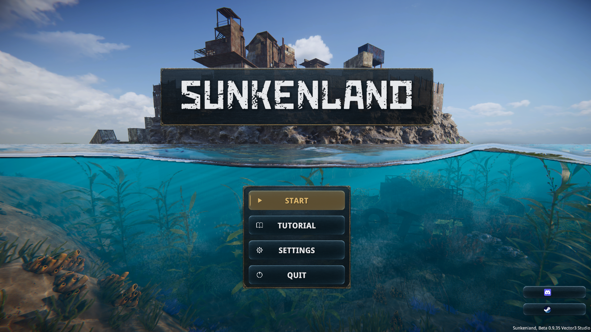
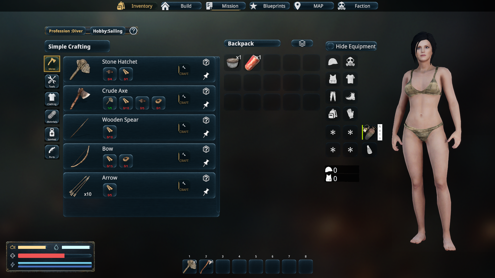
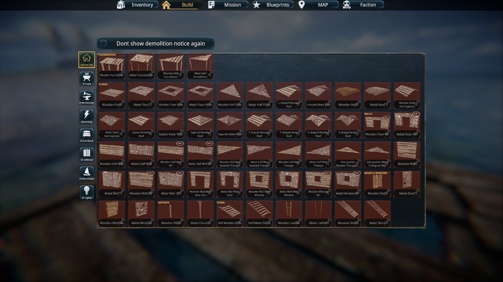
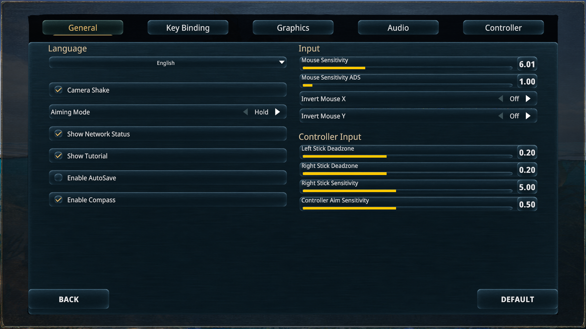
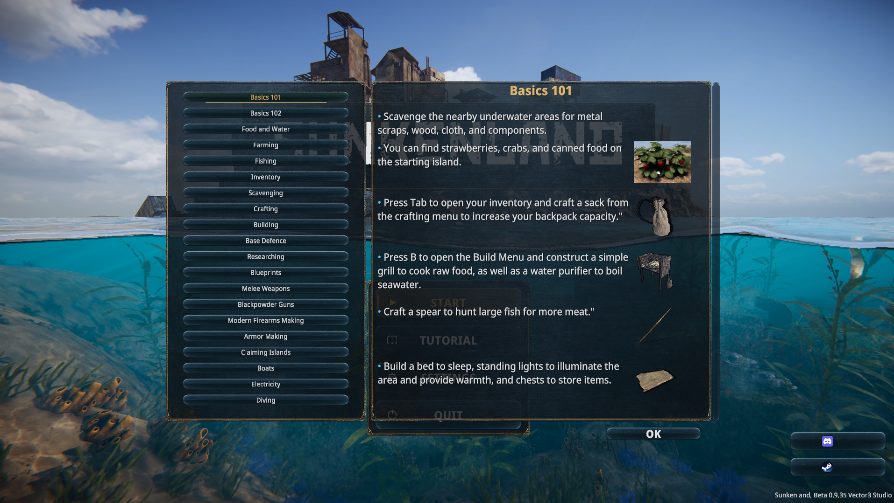
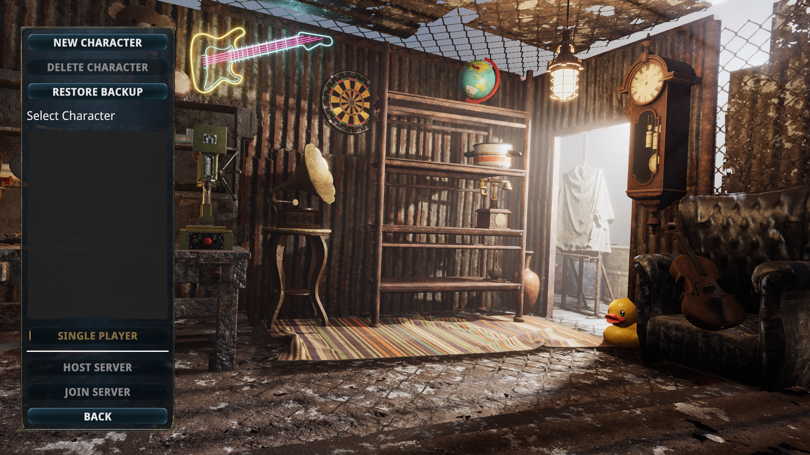

# Reef UI for Sunkenland

A navy and bronze interface for life after the flood. Reef UI replaces Sunkenland's rough UI backings with brushed metal, warm selection accents, rounded controls, and clearer spacing across menus, inventory, crafting, building, and the HUD.

**[Download Reef UI 0.9.1](https://github.com/theoneonlykid69/sunkenland-reef-ui/releases/download/v0.9.1/Sunkenland.ReefUI-0.9.1.zip)** · **[Installation guide](INSTALL.md)** · **[Release notes](RELEASE-NOTES-0.9.1.md)**

This is a free, unofficial community mod, unaffiliated with the Sunkenland developers. You need your own copy of Sunkenland. No game files or mod-loader binaries are distributed here. The mod is provided **as is, without warranty**; see [NOTICE.md](NOTICE.md) and the [MIT license](LICENSE).

## What changes

- A consistent metal and bronze style across the main menu, character and world screens, settings, loading, pause, tutorials, tips, and confirmation dialogs.
- Gold hover and selection feedback, revised food and water icons, spaced vitals, and styled quest cards.
- Crafting cards with separate space for names, ingredient pictures, quantities, and actions.
- Building pieces grouped by function, then shape and material, using the original game controls.
- A redesigned starting-background selection with benefits drawn from the game's localized option descriptions.

Reef UI styles the native interface. Inventory actions, building placement, quest progress, and saves retain the game's behavior. The theme applies automatically while installed; there is no theme toggle.

## Install

1. Install **BepInEx 5 for Windows x64 / Unity Mono** separately. The tested loader is **5.4.23.6**.
2. Set `HideManagerGameObject = true` under `[Chainloader]` in `BepInEx/config/BepInEx.cfg`.
3. With the game closed, extract **Sunkenland.ReefUI-0.9.1.zip** from [Releases](https://github.com/theoneonlykid69/sunkenland-reef-ui/releases/tag/v0.9.1) into the game folder.
4. Start the game through Steam.

The [installation guide](INSTALL.md) covers the exact folder layout, updating, removal, and troubleshooting. Download the mod release ZIP; GitHub's automatic source-code archives do not contain an installable DLL.

## Screenshots

These author-supplied screenshots show version **0.9.0**. Version 0.9.1 adds the starting-background selection described in the release notes. Screenshot provenance is recorded in [docs/SCREENSHOTS.md](docs/SCREENSHOTS.md).

| Inventory and crafting | Organized building pieces |
| --- | --- |
|  |  |

| Settings | Tutorial |
| --- | --- |
|  |  |

## Compatibility

| Component | Development baseline |
| --- | --- |
| Game | Sunkenland Beta 0.9.35 |
| Platform | Windows x64 |
| Engine | Unity Mono 2021.3.45f2 |
| Loader | BepInEx 5.4.23.6, with `HideManagerGameObject = true` |

Other game versions, platforms, and combinations with other UI mods have not been confirmed. Game updates can change native UI fields and require a mod update.

The author checked the finished 0.9.1 selection interface in-game before release.

Styling runs when scenes and relevant UI screens are created or changed. There is no recurring hierarchy scan or per-frame styling loop. Static release checks inspect the compiled mod and its native hook targets; they do not measure gameplay FPS or guarantee performance on every system.

## Scope and known limits

Reef UI changes presentation and organization. It does not change character models, add clothing, rebalance perks, or alter save formats. The journal retains its paper artwork. Starting benefits use the game's own descriptions, including its original wording and rounding.

Building group row breaks depend on available native placeholder space, so a group can begin partway through a row. Native tooltip ingredient lists retain their original geometry. Some fixed tutorial illustrations contain UI examples from the base game.

## Report a problem

Open an [issue](https://github.com/theoneonlykid69/sunkenland-reef-ui/issues) with the game version, Reef UI version, affected screen, and a screenshot where useful. Include the relevant section of `BepInEx/LogOutput.log` after removing personal paths or information you do not want to publish. For a slowdown, describe when it begins and whether restarting with Reef UI removed changes it.

## Source and credits

See [BUILDING.md](BUILDING.md) to build with references from your own game installation. Release archives include only the mod, its artwork, and documentation. Dependencies and their owners are listed in [THIRD_PARTY.md](THIRD_PARTY.md).

The two metal textures were generated with OpenAI's image generation tool. Prompts and provenance are in [Assets/ARTWORK.md](Assets/ARTWORK.md). Screenshots depict Sunkenland; the game's artwork and trademarks remain with their respective owners and are not relicensed under the mod's MIT license.
